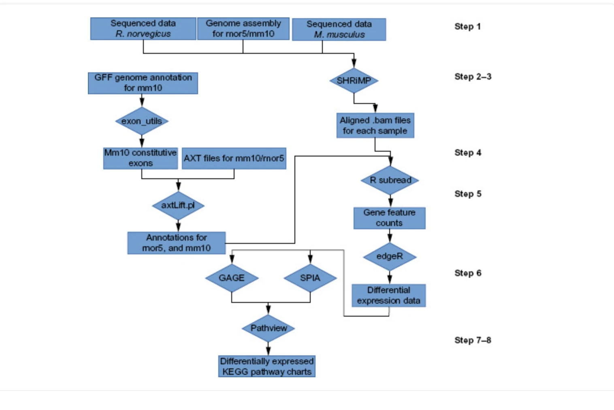

> LoVerso PR, Cui F (2015). A Computational Pipeline for Cross-Species Analysis of RNA-seq
> Data Using R and Bioconductor. *Bioinformatics and Biology Insights* 9:165-174.
> <https://doi.org/10.4137/BBI.S30884>. Open access under CC BY-NC 3.0.
> Read on [PubMed Central](https://pmc.ncbi.nlm.nih.gov/articles/PMC4668955/).
> Scripts: <https://github.com/ploverso>.

::: {.scan-note}
Reading in progress.
:::

| Field | |
|---|---|
| **Year** | 2015 |
| **Models** | **Mouse and rat**, as the worked example. The protocol is written for any pair of species |
| **Brain region** | Not applicable; a methods protocol |
| **Measures** | **RNA** |
| **Method** | Bulk RNA-seq. Reads aligned to each species' own genome with SHRiMP |
| **Cross-species stats** | One reference annotation (mouse mm10), constitutive exons only, lifted onto rat through UCSC whole genome alignments. Exons that do not match completely are discarded. Counts with Rsubread, differential expression with **edgeR**, pathways with GAGE, SPIA and Pathview |

: {tbl-colwidths="[22,78]"}

::: {.scan-note}
Figure reproduced from LoVerso and Cui 2015, *Bioinformatics and Biology Insights* 9:165-174,
under CC BY-NC 3.0. [Original paper](https://doi.org/10.4137/BBI.S30884).
:::

## My reading

In this paper there is a graph that looks at the **computational pipeline for cross-species
expression analysis using RNA sequencing**, and I suppose this is what I will be looking at.

Step one is, I suppose, getting the **sequence data**. Step two is somewhat confusing. It says
**GFF genome annotation** and **SHRiMP**. There is a GitHub repo, as it seems. At this point I
am a bit confused as to what is happening, and I suppose this is the best guide on how to do
this.

I think I understand now. They use the **genomes first**. They have a **genome assembly** and
the **sequence data** for both species. Then they have the **GFF genome annotation for one
species**. They use **SHRiMP**, which is a software.

So we can think about how we need to address this for our project, and where we can input the
workflows that we have encountered today.

## Checks against the paper

- **What happens in step two?** Steps 2 and 3 are only the right hand column: SHRiMP aligns each
  species' reads to its own genome, giving one BAM file per sample. The left hand column, from
  the GFF annotation down, is step 4: the mouse annotation is cut down to constitutive exons
  (exons always included in the final gene product) and lifted onto the rat genome with
  `axtLift.pl`, so both species are counted against the same exons.
